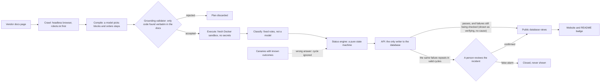

# QuickstartRot

Re-runs developer quickstarts on a clean machine on a schedule and publishes which ones still work, with the evidence.

Live site: <https://quickstartrot.vercel.app>. It reports what happened and does not rank or review products. A quickstart is shown as failing only after a person has confirmed it; until then it shows as "being verified", with no cause.

- How a quickstart is tested and what a pass proves: [Methodology](https://quickstartrot.vercel.app/methodology)
- The crawler, its user agent and how to opt out: [QuickstartRotBot](https://quickstartrot.vercel.app/bot)
- What we send to the services we test: [About our traffic](docs/ABOUT-OUR-TRAFFIC.md)
- How we tell a vendor about a failure: [Disclosure policy](docs/DISCLOSURE.md)

## Status now

<!-- qsr:status:start -->

**50 of 50** quickstarts work on a fresh machine right now. Every quickstart is run on a fresh machine every 6 hours, and a failure is shown as "being verified" until a person has confirmed it.

| Tested up to                           | Passing | Being verified | Confirmed failing | Tested |
| -------------------------------------- | ------: | -------------: | ----------------: | -----: |
| L3 (reached the vendor's API)          |       3 |              0 |                 0 |      3 |
| L2 (installs, builds, imports resolve) |      47 |              0 |                 0 |     47 |

1 more needs a person (a sign-up or an interactive step); they are not counted above.

As of 2026-10-18 16:02 UTC, from the [site's status counts](https://quickstartrot.vercel.app/api/status).
<!-- qsr:status:end -->

## What each level proves

A pass means different things at different levels, so the site counts them separately. The wording below is generated from the measurement in [docs/DETECTION-POWER.md](docs/DETECTION-POWER.md).

<!-- qsr:detection:start -->

A green L2 badge means the quickstart installs, parses and its imports resolve. In our own tests, planting broken code in 35 quickstarts, L2 noticed 64 of 121 planted breakages, all of them syntax errors and import paths that do not exist; it noticed none of the 55 renamed names, renamed methods or misnamed options, because those only exist at run time. Level 3, where the snippet reaches the vendor, rests on 2 quickstarts so far and we quote no rate for it. (Broken install commands are caught by npm and pip, 90 of 90, and say nothing about the code.)

3 quickstarts reach L3 in production; the detection measurement covers 2 of them, because vendor calls are off during mutation runs.

- **L1:** A pass at L1 means the package named in the install command exists and installs on a clean machine today. It does not say the code works.
- **L2:** A pass at L2 means the install works, the code parses, and the packages it imports resolve. It does not mean the names the code uses still exist: at L2 our planted renamed imports were noticed 0 of 16 times, renamed methods 0 of 15 and misnamed options 0 of 24.
- **L3:** A pass at L3 means the snippet ran against the vendor's own client library and the vendor's answer, an authentication error for a made-up key, shows it was reached. It does not show the options are right. It rests on 2 quickstarts (anthropic-node, resend-node), so we quote no detection rate for it.
- **Executed locally (no vendor):** Some quickstarts are libraries with no service behind them. 3 targets are of that kind here. Their snippet runs on our machine and counts as such; it never counts as Level 3.

4 more quickstarts run their Level 3 step as a trial, labelled verifying: the result is recorded and not counted.

Install-level and code-level results are never added together. None of this measures how often real quickstarts break; it measures what the monitor can see. The method, every survivor and the raw data: [docs/DETECTION-POWER.md](docs/DETECTION-POWER.md).
<!-- qsr:detection:end -->

## How it works



The model never writes code: only code found verbatim in the docs is run. The execute job holds no secrets and never calls the API. A failure becomes public only after the same failure repeats in valid cycles and a person has reviewed it.

## Add a quickstart

Open an issue with the **Add a quickstart** form, or send a pull request with a file in `targets/`:

```yaml
slug: example-node
name: Example (Node.js)
docsUrl: https://docs.example.com/quickstart
language: node
level: 2
enabled: false
runtime:
  image: ghcr.io/aditya-tec/qsr-node:22
  nodeVersion: '22'
extract:
  root: article
notes: 'Which page, which code blocks, and anything a tester should know.'
```

A new target starts with `enabled: false`. A maintainer turns it on only after reproducing a run in Docker and reading the log. What we accept, what we do not, and how to check a file: [CONTRIBUTING.md](CONTRIBUTING.md).

## Badge

Every tracked quickstart has a badge you can put in your own README. It shows `quickstart | passing`, `failing`, `verifying`, `unknown` or `needs a person`, and links back to the tool page. "failing" appears only after a person confirmed the failure; until then the badge says "verifying".

Markdown (replace `resend-node` with the slug of your tool, which is the last part of its page URL):

```markdown
[](https://quickstartrot.vercel.app/tools/resend-node)
```

HTML:

```html
<a href="https://quickstartrot.vercel.app/tools/resend-node"
  ></a>
```

The badge is a small self-contained SVG and is cached, so it can lag the page. A slug that is not tracked shows `not tracked`.

## Honest limits

- **A pass is not a guarantee.** It means the quickstart worked in our environment at that time, up to the stated level. It does not show that it works on your machine, with your version of Node.js or Python, or with a real key.
- **Levels differ.** An L2 pass proves much less than an L3 pass. Compare like with like.
- **The measurement above is about the monitor.** It does not measure how often real quickstarts break; it measures what the monitor can see. L3 rests on a few quickstarts, so we quote no detection rate for it.
- **Plans are model-assisted.** The grounding check stops invented code, but the model may pick the wrong blocks or miss a step. That shows up as a failure or a skipped step that a person reviews, never as a public claim without one.
- **Coverage is small and chosen by hand.** Only Node.js and Python quickstarts that run in a terminal are covered.
- **The data is cached**, so the site and the badge can be a few minutes behind.

## Ethics and traffic

- The crawler obeys `robots.txt` and identifies itself as `QuickstartRotBot` with a contact page. It never automates sign-ups, solves CAPTCHAs, or uses real vendor API keys.
- For some quickstarts the check runs the documentation's own code, which makes a request to the service's API with an invalid, made-up credential. Which services, and how often, is in [docs/ABOUT-OUR-TRAFFIC.md](docs/ABOUT-OUR-TRAFFIC.md).
- A vendor can ask a question or ask us to stop with the [opt-out form](https://github.com/Aditya-tec/quickstartrot/issues/new?template=opt-out.yml). What we promise a vendor is the generated sentence below.
- Before a failure is made public we tell the vendor privately and wait: [docs/DISCLOSURE.md](docs/DISCLOSURE.md). A transient or infrastructure failure is never made public.

<!-- qsr:promise:start -->

Probing stops within 24 hours of an opt-out request, and we reply in writing within 3 business days.
<!-- qsr:promise:end -->

## Development

```
pnpm install
pnpm build
pnpm typecheck && pnpm test && pnpm lint && pnpm format:check
```

The website runs without any credentials on seeded data: `QSR_DATA=fixtures pnpm --filter @qsr/web dev` (see `apps/web/README.md`). Conventions and the rules that must never be broken: [AGENTS.md](AGENTS.md). Deploying: [DEPLOY.md](DEPLOY.md). To refresh the generated blocks of this file: `pnpm qsr readme`, then `pnpm format`.

## License

Released under the [MIT License](LICENSE). Copyright (c) Aditya Kalambe.
